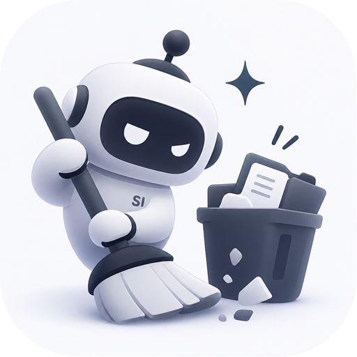
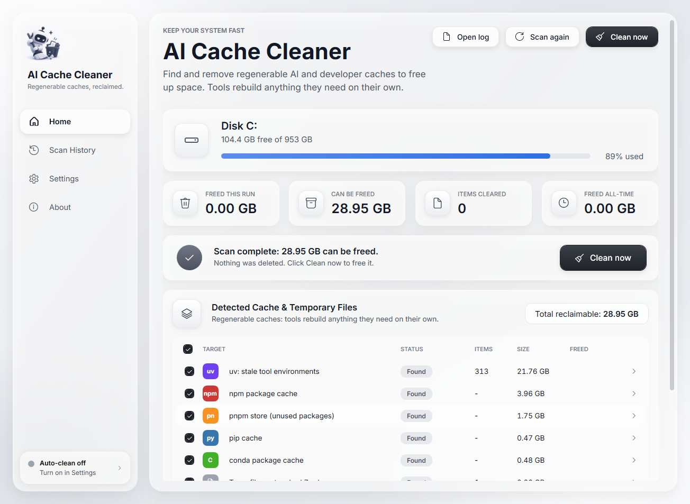
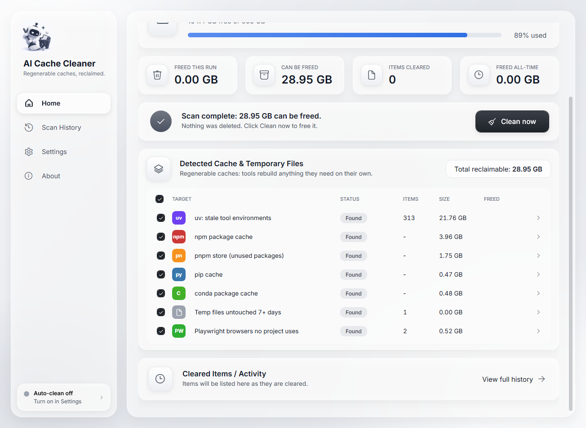
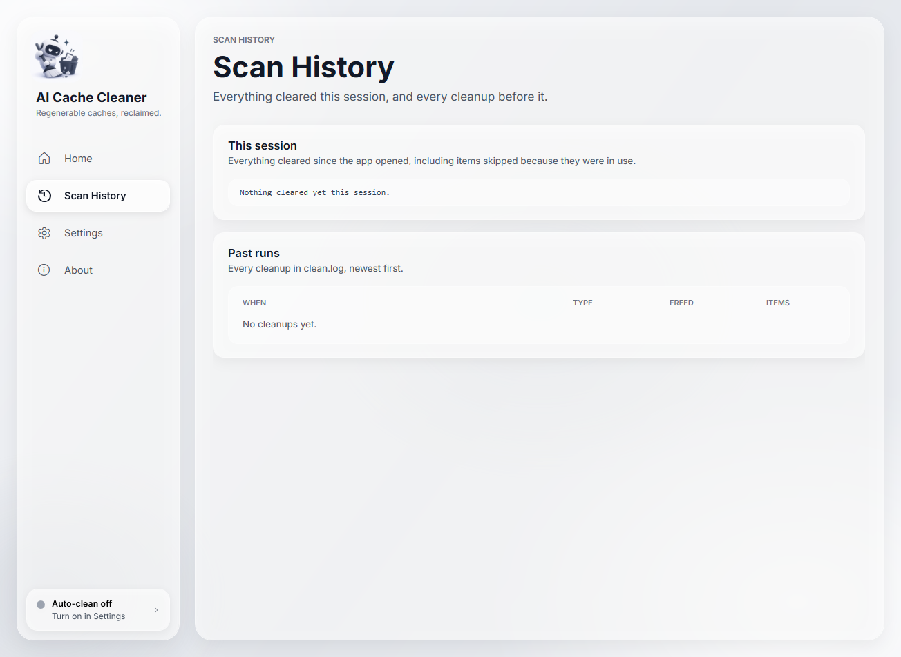
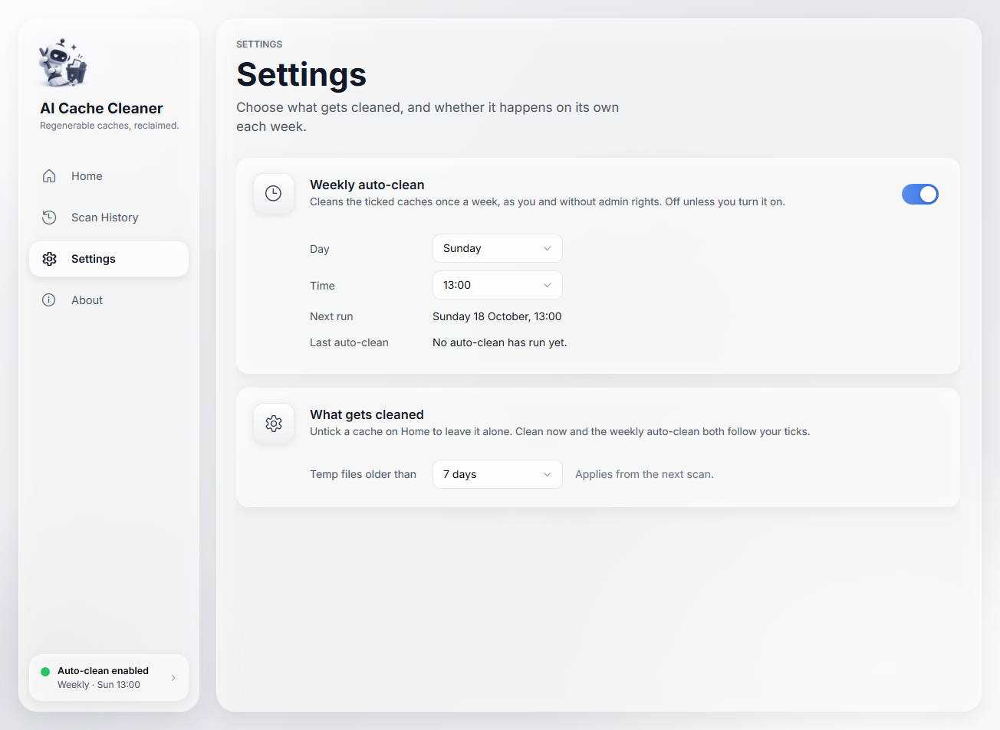
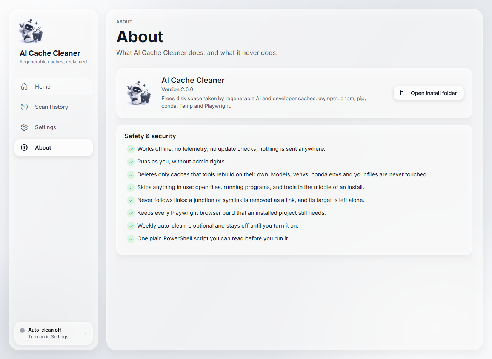

<p align="center">
  
</p>

<h1 align="center">oopSI - AI Cache Cleaner</h1>

<p align="center">
  <b>Clean Windows AI leftovers safely.</b> Free gigabytes of disk space from uv / uvx, npm, pnpm, pip, conda, Temp and old Playwright browsers.<br>
  Offline, no admin rights, open source. Built for people who use Claude Code, Cursor, Codex, Windsurf, MCP servers and other AI dev tools.
</p>

<p align="center">
  <a href="https://github.com/AlienEmperor604/OopSI/releases/latest"></a>
  
  
  
  <a href="LICENSE"></a>
</p>

https://github.com/user-attachments/assets/34270ec8-e9e3-4791-a1f4-4b23be0c26c8

<p align="center">
  
</p>

## Why your C: drive fills up when you use AI tools

AI coding tools and MCP servers quietly leave regenerable caches behind:

- **uv / uvx**: every `uvx` call and every Python MCP server started with `uv run --with` creates a cached virtual environment (0.1 to 0.3 GB each). Hundreds pile up in `%LOCALAPPDATA%\uv\cache`. One machine had **21.76 GB** of them.
- **npm, pnpm, pip, conda**: package caches from every `npx` MCP server, agent tool install and notebook setup.
- **Playwright**: each Playwright version downloads its own Chromium, Firefox and WebKit builds (0.5 GB or more per version), and old builds are never removed.
- **Temp**: installers and tools leave files in `%TEMP%` that Windows never clears.

AI Cache Cleaner finds these, shows exactly what can go, and removes only what the tools rebuild on their own. It never touches your models, your projects or anything in use.

## Features

- **One-click scan and clean** in a native Windows app (light glass UI), with live progress per cache.
- **Shows what it found before it deletes**: size and item count per cache, plus the item list behind each row.
- **Tick what to clean**: untick any cache to leave it alone. Your choice is remembered.
- **Safe by design**: skips files and programs in use, never follows junctions or symlinks, keeps every Playwright build an installed project still needs. Details in [Safety & security](#safety--security).
- **Optional weekly auto-clean**, off by default and turned on with one switch in Settings.
- **History**: every cleanup is logged, with the space freed and the number of items.
- **No install footprint**: one readable PowerShell script plus a tiny launcher it compiles on your machine. No admin rights, no service, no network.
- **Agent friendly**: an [AGENTS.md](AGENTS.md) lets Claude Code, Codex, Cursor or any coding agent install and run it for you.

## Quick start

**Option 1: download** (no git needed)

1. Download `ai-cache-cleaner-v2.0.3.zip` from the [latest release](https://github.com/AlienEmperor604/OopSI/releases/latest) and extract it.
2. Double-click **install.cmd**.
3. AI Cache Cleaner opens and scans. Nothing is deleted until you click **Clean now**.

If Windows SmartScreen says "Windows protected your PC", click **More info**, then **Run anyway**. You can also unblock the files first in PowerShell:
`Get-ChildItem -Path .\ai-cache-cleaner -Recurse | Unblock-File`

**Option 2: git clone**

```powershell
git clone https://github.com/AlienEmperor604/OopSI.git
cd OopSI
.\install.cmd
```

**Option 3: let your AI agent do it**

Open this folder in Claude Code, Codex, Cursor, Windsurf or another coding agent and say:

> Install AI Cache Cleaner from this folder. Follow AGENTS.md.

The agent self-tests the tool, installs it, does a dry run and tells you how much space you can free. It won't delete anything unless you ask.

The full walkthrough, with every screen explained, is in the **[How-to guide](docs/GUIDE.md)**.

## Screenshots

| Detected caches | Scan history |
|---|---|
|  |  |
| **Settings** | **About** |
|  |  |

## What it cleans

| Cache | Where | How it's cleaned |
|---|---|---|
| **uv: stale tool environments** (uvx, `uv run --with`, Python MCP servers) | `%LOCALAPPDATA%\uv\cache\archive-v0` | Deletes only real environments (`pyvenv.cfg` plus `Lib\site-packages`) created over a day ago that no running process uses, plus their link files. uv rebuilds one the next time it's needed. |
| **npm package cache** | `%LOCALAPPDATA%\npm-cache\_cacache` | `npm cache clean --force` |
| **pnpm store** | `%LOCALAPPDATA%\pnpm\store` | `pnpm store prune` (only packages no project references) |
| **pip cache** | `%LOCALAPPDATA%\pip\cache` | `pip cache purge` |
| **conda package cache** | `%USERPROFILE%\.conda\pkgs` | `conda clean --tarballs --index-cache --logfiles -y` (downloaded archives only; installed packages stay) |
| **Temp files** | `%TEMP%` | Files and folders untouched for 7+ days (you can change the age), the same rule Windows Disk Cleanup uses. |
| **Unused Playwright browsers** | `%LOCALAPPDATA%\ms-playwright` | Reads every Playwright install registered in `.links` and keeps every browser build those installs need. Only builds that no installed project uses are removed. |

Each tool is skipped while it's installing something (for example during `npm install` or `playwright install`).

## What it never deletes

- AI models: Hugging Face, LM Studio, Ollama, ComfyUI, PyTorch hub
- virtual environments (venvs) and conda environments
- Python, Node or any other installed runtime
- your projects, documents and other files

Running the tool from the command line with no options (a dry run) also lists the biggest models and environments on your machine, so you can decide about those yourself.

## Safety & security

- **Works offline.** No telemetry, no update checks, nothing is sent anywhere.
- **Runs as you, without admin rights.** It can only touch what your own account can.
- **Only caches that tools rebuild.** Everything it removes is downloaded or rebuilt automatically the next time a tool needs it.
- **Skips anything in use.** Open files, programs running from a cache folder (for example an MCP server running from a uv environment), and tools in the middle of an install.
- **Never follows links.** A junction or symlink inside a cache is removed as a link; its target is left alone.
- **Keeps the Playwright builds your projects need**, and deletes nothing at all if it can't read every Playwright registration.
- **Weekly auto-clean is optional** and off until you turn it on. It runs as you with limited rights, only while you're logged on.
- **One plain PowerShell script** you can read before you run it. The launcher exe is compiled on your machine from source inside that script. Its built-in self-test (`-Test`) checks all of the above in a throwaway folder.

Found a problem? See [SECURITY.md](SECURITY.md).

## Command line

```powershell
$t = "$env:USERPROFILE\.ai-cache-cleaner\ai-cache-cleaner.ps1"
$ps = "$env:SystemRoot\System32\WindowsPowerShell\v1.0\powershell.exe"
& $ps -NoProfile -ExecutionPolicy Bypass -File $t                        # dry run: what can be freed, deletes nothing
& $ps -NoProfile -ExecutionPolicy Bypass -File $t -Clean                 # clean now (skips caches you unticked)
& $ps -NoProfile -ExecutionPolicy Bypass -File $t -Gui                   # open the app
& $ps -NoProfile -ExecutionPolicy Bypass -File $t -Schedule -Day Sunday -Hour 13   # weekly auto-clean on
& $ps -NoProfile -ExecutionPolicy Bypass -File $t -Unschedule            # weekly auto-clean off
& $ps -NoProfile -ExecutionPolicy Bypass -File $t -Test                  # self-test
& $ps -NoProfile -ExecutionPolicy Bypass -File $t -Uninstall             # remove everything
```

Every cleanup is logged to `%USERPROFILE%\.ai-cache-cleaner\clean.log`. Your ticks and Temp age live in `settings.json` next to it.

## FAQ

**How do I clean AI leftovers on Windows?**
Install AI Cache Cleaner, let it scan, then click **Clean now**. It removes stale uv/uvx environments, npm, pnpm, pip and conda caches, old Temp files and Playwright browsers nothing uses.

**Why is my C: drive full after using Claude Code, Cursor or MCP servers?**
Usually the uv cache. Every Python MCP server or `uvx` tool gets its own cached environment, and `uv` never removes old ones. Add npm caches from `npx`-based servers and Playwright browser downloads, and 20 to 40 GB is common.

**Is it safe to delete the uv cache?**
Yes, uv recreates what it needs. But `uv cache clean` or `uv cache prune` also deletes environments that running MCP servers are using right now. AI Cache Cleaner skips those, and anything created in the last day.

**Is it safe to delete old Playwright browsers?**
Only the ones no project uses. Deleting by age breaks projects pinned to an older Playwright version. AI Cache Cleaner reads Playwright's own install registry and keeps every build a project still needs.

**Will it delete my Hugging Face, Ollama or LM Studio models?**
No. Models, venvs and conda environments are never deleted. The dry run lists them so you can review them yourself.

**Does it need admin rights or internet?**
No and no. It runs as your user and works fully offline.

**How much space will I get back?**
It depends on how much you use AI and dev tools. The scan shows the exact number before anything is deleted. On the machine in the screenshots it found 28.95 GB.

**Can I schedule it?**
Yes. Turn on weekly auto-clean in Settings and pick a day and hour. It's off by default.

**How do I uninstall it?**
Run the uninstall command above. It removes the app, the desktop shortcut, its settings and log, and the weekly task if you turned it on.

## Requirements

Windows 10 or 11 with Windows PowerShell 5.1 and .NET Framework 4.x (both built into Windows).

## Contributing

Issues and pull requests are welcome. The whole tool is `ai-cache-cleaner.ps1`. Please keep it ASCII-only (Windows PowerShell 5.1 misreads UTF-8 without a BOM) and run the self-test before sending changes:

```powershell
& "$env:SystemRoot\System32\WindowsPowerShell\v1.0\powershell.exe" -NoProfile -ExecutionPolicy Bypass -File .\ai-cache-cleaner.ps1 -Test
```

Never test `-Clean` on a machine whose caches you care about without a dry run first.

## License

[MIT](LICENSE). The bundled Lato font (Google Fonts) is licensed under the SIL Open Font License ([fonts/OFL.txt](fonts/OFL.txt)).

<sub>Keywords: clean Windows AI leftovers, AI cache cleaner, free up disk space Windows 11, clear uv cache, uvx cache, MCP server cache, npm cache clean, pnpm store prune, pip cache purge, conda clean, delete old Playwright browsers, ms-playwright folder, Temp files cleanup, Claude Code, Cursor, Codex, Windsurf, developer disk cleanup.</sub>
